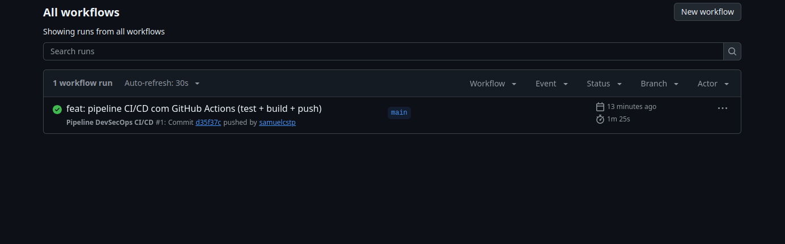
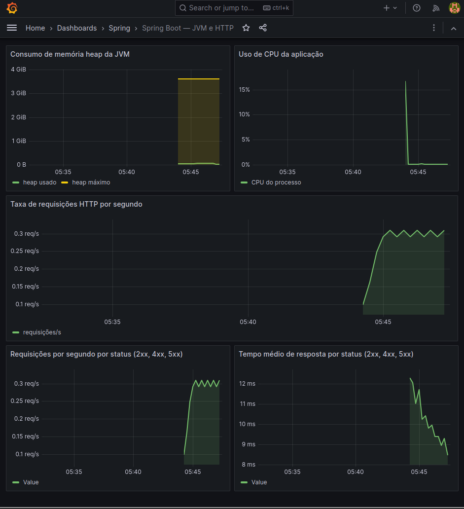
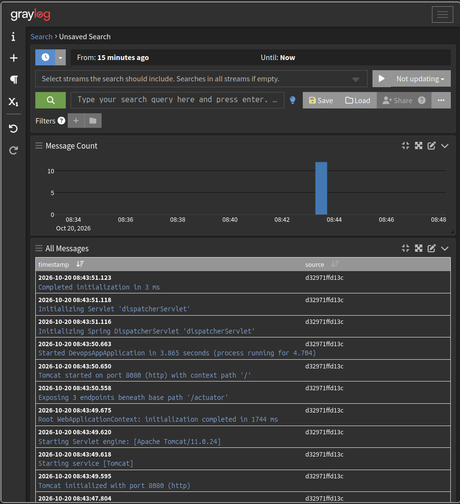

# Projeto DevOps: Spring Boot + Prometheus + Grafana + Graylog

Aplicação Spring Boot (`/greeting`) com Dockerfile multistage, pipeline no GitHub Actions e stack local de observabilidade.

## Pré-requisitos

- Docker e Docker Compose v2 (~3 GB de RAM livres)
- Linux: `sudo sysctl -w vm.max_map_count=262144` (exigência do OpenSearch)
- Secrets no GitHub: `DOCKERHUB_USERNAME` e `DOCKERHUB_TOKEN`

## Executar

```bash
docker compose up --build
```

O Graylog leva alguns minutos na primeira subida. O `graylog-setup` cria o input GELF sozinho e só então o app inicia.

| Serviço | URL | Login |
| --- | --- | --- |
| Aplicação | http://localhost:8080/greeting | - |
| Métricas | http://localhost:8080/actuator/prometheus | - |
| Prometheus | http://localhost:9090 | - |
| Grafana | http://localhost:3000 | admin / admin |
| Graylog | http://localhost:9000 | admin / admin |

Gerar tráfego para os gráficos e logs:

```bash
curl http://localhost:8080/greeting                      # 200 (DEBUG/INFO)
curl -i "http://localhost:8080/greeting?name=%20"        # 400 (ERROR)
curl -i http://localhost:8080/greeting/error             # 500 (ERROR)
curl "http://localhost:8080/greeting/slow?delay=1000"    # 200 lento (INFO)
```

Encerrar: `docker compose down`

## Arquitetura

- **app**: jar gerado em estágio Maven e executado em `eclipse-temurin:17-jre-alpine`. Logback envia GELF para `graylog:12201` (profile `docker`).
- **prometheus**: coleta `app:8080/actuator/prometheus` a cada 5 s.
- **grafana**: datasource e dashboard **Spring Boot — JVM e HTTP** provisionados (heap, CPU, RPS, contagem e tempo por status 2xx/4xx/5xx).
- **graylog + mongodb + opensearch**: Graylog 5.2 com OpenSearch 2.11.

## Pipeline

`.github/workflows/ci-cd.yml` roda em push e PR para `main`/`master`: testes (`mvn clean test`), build multistage e push para `DOCKERHUB_USERNAME/devops-app:latest`.

## Evidências

**Pipeline:**


**Grafana:**


**Graylog:**
